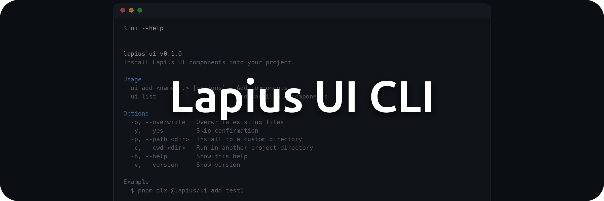

<div align="center">

<p align="center">
  
</p>

<p align="center"><a href="README.md">English</a> | <b>日本語</b></p>

<h1 align="center">Lapius UI CLI</h1>

<h3 align="center">Lapius UI のコンポーネントを、1 コマンドでプロジェクトに追加します。</h3>

<p align="center">Lapius UI のコンポーネントを入れる小さな CLI です。レジストリを確かめてから、shadcn CLI を呼びます。</p>

<p align="center">
  <a href="https://www.npmjs.com/package/@lapius/ui"></a>
  <a href="https://ui.shadcn.com"></a>
  <a href="LICENSE"></a>
  <a href="https://github.com/Lapius7/ui-cli/stargazers"></a>
  <a href="https://github.com/Lapius7/ui-cli/commits/main"></a>
</p>

<p align="center"><a href="#最短セットアップ">最短セットアップ</a> · <a href="#コマンド">コマンド</a> · <a href="#動作の流れ">動作の流れ</a> · <a href="#開発">開発</a></p>

</div>

---

## 特長

- **名前で追加**: `ui add <name...>` で、コンポーネントを 1 つ以上追加します。
- **打ち間違いに対応**: 名前を間違えると、近い候補を出します。例: 「test1 ではありませんか?」
- **パッケージマネージャーに合わせる**: 実行中の pnpm、bun、yarn、npm のどれかで shadcn を起動します。
- **色の切り替え**: `NO_COLOR=1` で色を消せます。

## 最短セットアップ

インストールせずに実行できます。Node.js 18 以上と、shadcn でコンポーネントを追加できるプロジェクトが要ります。

```sh
pnpm dlx @lapius/ui list
pnpm dlx @lapius/ui add test1
```

コマンドは `ui` と `lapius-ui` の 2 つです。

## コマンド

| コマンド | 内容 |
|---|---|
| `ui add <name...>` | コンポーネントを追加します（複数可）。名前を間違えると近い候補を出します |
| `ui list` | 使えるコンポーネントの一覧（別名 `ui ls`） |

| オプション | 内容 |
|---|---|
| `-o`, `--overwrite` | 既存のファイルを上書き |
| `-y`, `--yes` | 確認を省略 |
| `-p`, `--path <dir>` | 別のディレクトリに入れる |
| `-c`, `--cwd <dir>` | 別のプロジェクトのディレクトリで実行 |
| `-h`, `--help` / `-v`, `--version` | ヘルプ / バージョン |

オプションは、そのまま shadcn に渡します。

## 動作の流れ

1. `ui add` は `https://shadcn.lapius7.com/r/registry.json` を取得し、名前がすべて存在するか確かめます。
2. 実行中のパッケージマネージャー（`pnpm dlx`、`bunx --bun`、`yarn dlx`、`npx --yes`）で、`shadcn@latest add https://shadcn.lapius7.com/<name>` を実行します。

## 安全のために

> [!NOTE]
> 未検証: 実際のプロジェクトでの `ui add` の通し実行。`ui --help` はローカルで実行しました。レジストリの URL は応答し、現在は `test1`（Spotlight Card）の 1 件だけが載っています。`src/cli.ts` の版は `0.1.0` ですが、`package.json` は `0.1.1` です。

## 開発

```sh
bun install && bun run build && node dist/cli.js --help
```

`bun run typecheck` で `tsc --noEmit` を実行します。

## ライセンス

[MIT](LICENSE)
